<!-- Generated by scripts/build.mjs from azanello.com — edit the script, not this file. -->

<!-- posts:start -->
- [Shipping a Remote MCP Server That Works in Both ChatGPT and Claude: A Field Guide](https://azanello.com/blog/remote-mcp-server-chatgpt-claude-guide)
- [Who Signs Off When Agents Write the Code? Risk-Tiered Approval in an AI-First SDLC](https://azanello.com/blog/risk-tiered-approval-ai-first-sdlc)
- [Layered AI Code Review: Commit-Time, PR-Time and Human Review That Don't Step on Each Other](https://azanello.com/blog/layered-ai-code-review-workflow)
- [Bounded Autonomy: How to Let a Coding Agent Push Fixes Without Letting It Ship](https://azanello.com/blog/bounded-autonomy-coding-agents)
- [Separate Talking From Acting: A Guardrail Architecture for Production AI Agents](https://azanello.com/blog/ai-agent-guardrails-architecture)
- [All 22 posts →](https://azanello.com/blog)
<!-- posts:end -->

Built from live data on <a href="https://azanello.com">azanello.com</a> · refreshed daily · 22 certifications on <a href="https://www.credly.com/users/azanello">Credly</a>
