<!-- Generated by scripts/build.mjs from azanello.com — edit the script, not this file. -->
<a href="https://azanello.com"><picture><source media="(prefers-color-scheme: dark)" srcset="assets/header-dark.svg"></picture></a>

<a href="https://azanello.com/hire"><picture><source media="(prefers-color-scheme: dark)" srcset="assets/btn-hire-dark.svg"></picture></a>
<a href="https://app.azanello.com/en/services"><picture><source media="(prefers-color-scheme: dark)" srcset="assets/btn-project-dark.svg"></picture></a>
<a href="https://azanello.com/Alejandro_Zanello_Resume.pdf"><picture><source media="(prefers-color-scheme: dark)" srcset="assets/btn-cv-dark.svg"></picture></a>
<a href="https://azanello.com/graph"><picture><source media="(prefers-color-scheme: dark)" srcset="assets/btn-graph-dark.svg"></picture></a>
<a href="https://www.linkedin.com/in/alejandrozanello/"><picture><source media="(prefers-color-scheme: dark)" srcset="assets/btn-linkedin-dark.svg"></picture></a>

<a href="https://azanello.com"><picture><source media="(prefers-color-scheme: dark)" srcset="assets/results-dark.svg"></picture></a>

<picture><source media="(prefers-color-scheme: dark)" srcset="assets/section-work-dark.svg"></picture>

<a href="https://github.com/AleSZanello/akashi_agents"><picture><source media="(prefers-color-scheme: dark)" srcset="assets/spotlight-akashi-dark.svg"></picture></a>

<a href="https://github.com/AleSZanello/avatar_lipsync"><picture><source media="(prefers-color-scheme: dark)" srcset="assets/card-avatar_lipsync-dark.svg"></picture></a>
<a href="https://github.com/somnio-software/somnio-ai-tools"><picture><source media="(prefers-color-scheme: dark)" srcset="assets/card-somnio-ai-tools-dark.svg"></picture></a>

<a href="https://github.com/AleSZanello/mcp-deep-dive"><picture><source media="(prefers-color-scheme: dark)" srcset="assets/card-mcp-deep-dive-dark.svg"></picture></a>
<a href="https://github.com/AleSZanello/langgraph-ts-agents"><picture><source media="(prefers-color-scheme: dark)" srcset="assets/card-langgraph-ts-agents-dark.svg"></picture></a>

<a href="https://github.com/AleSZanello/langgraph-langserve-starter"><picture><source media="(prefers-color-scheme: dark)" srcset="assets/card-langgraph-langserve-starter-dark.svg"></picture></a>
<a href="https://github.com/AleSZanello/local-rag-chatbot"><picture><source media="(prefers-color-scheme: dark)" srcset="assets/card-local-rag-chatbot-dark.svg"></picture></a>

<picture><source media="(prefers-color-scheme: dark)" srcset="assets/stack-dark.svg"></picture>

<picture><source media="(prefers-color-scheme: dark)" srcset="assets/section-writing-dark.svg"></picture>

<!-- posts:start -->
- [Shipping a Remote MCP Server That Works in Both ChatGPT and Claude: A Field Guide](https://azanello.com/blog/remote-mcp-server-chatgpt-claude-guide)
- [Who Signs Off When Agents Write the Code? Risk-Tiered Approval in an AI-First SDLC](https://azanello.com/blog/risk-tiered-approval-ai-first-sdlc)
- [Layered AI Code Review: Commit-Time, PR-Time and Human Review That Don't Step on Each Other](https://azanello.com/blog/layered-ai-code-review-workflow)
- [Bounded Autonomy: How to Let a Coding Agent Push Fixes Without Letting It Ship](https://azanello.com/blog/bounded-autonomy-coding-agents)
- [Separate Talking From Acting: A Guardrail Architecture for Production AI Agents](https://azanello.com/blog/ai-agent-guardrails-architecture)
- [All 22 posts →](https://azanello.com/blog)
<!-- posts:end -->

Built from live data on <a href="https://azanello.com">azanello.com</a> · refreshed daily · 22 certifications on <a href="https://www.credly.com/users/azanello">Credly</a> · <a href="https://azanello.com/graph">knowledge graph</a>
